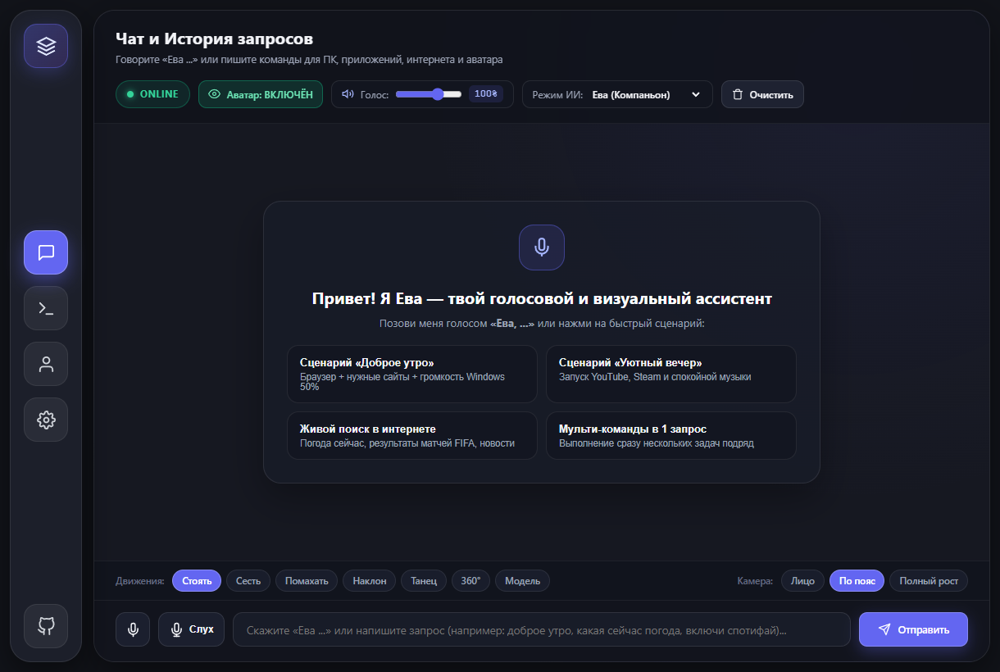
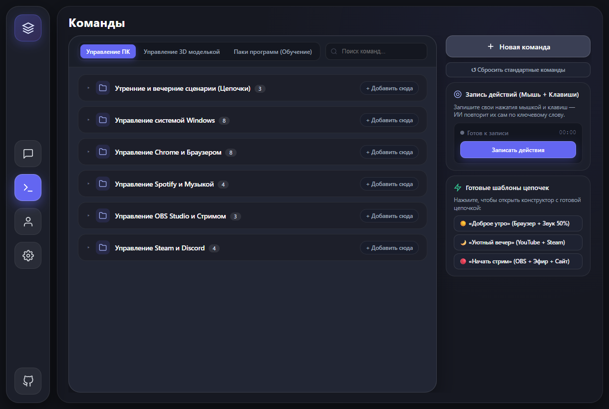
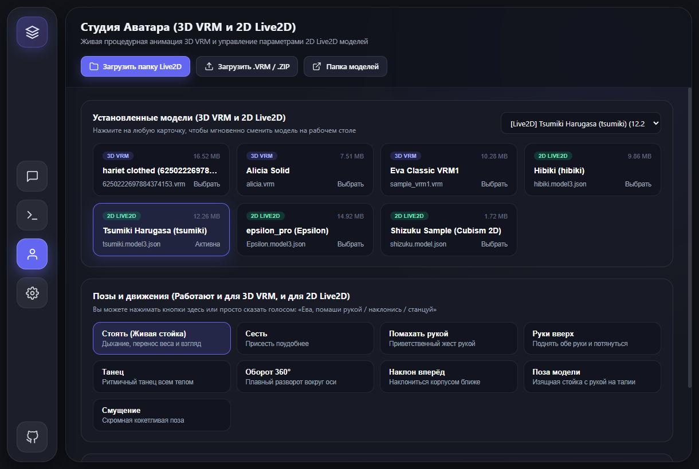
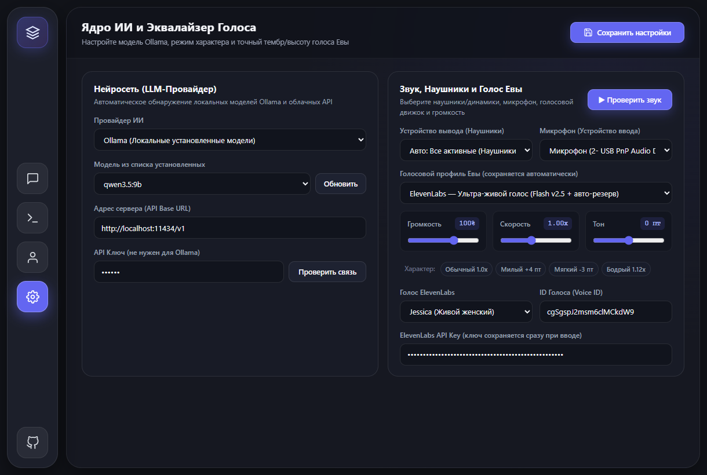

<div align="center">

# ⚡ EVA AI & J.A.R.V.I.S. — Spatial 3D & Live2D Desktop Assistant

**Автономный голосовой ИИ-компаньон и тактический ассистент для Windows 10/11 с живым 3D VRM / 2D Live2D аватаром на рабочем столе, управлением ПК, 100+ голосовыми командами, эквалайзером голоса и локальными/облачными нейросетями.**

[](https://github.com/paraxyoz/EVA-AI-Assistant/releases)
[](https://github.com/paraxyoz/EVA-AI-Assistant)
[](https://www.python.org/)
[](https://github.com/paraxyoz/EVA-AI-Assistant)
[](https://ollama.com/)

</div>

---

## 📸 Интерфейс приложения

| 💬 Диалог с Евой / J.A.R.V.I.S. | ⚡ Центр Команд и 15+ Паков Программ |
| :---: | :---: |
|  |  |
| **🎭 3D VRM / Live2D Студия и Эквалайзер Голоса** | **🧠 Настройки ИИ (Ollama, Groq, Gemini, OpenRouter)** |
|  |  |

---

## ✨ Ключевые возможности (v5.0 Beta)

### 1. 🎭 Двухоконная архитектура: Живой 3D / Live2D Аватар + Центр Управления
* **Окно 1 — Прозрачный настольный компаньон**: живёт прямо поверх рабочего стола Windows без фона и рамок. Поддерживает как **3D-модели (`.vrm`)**, так и **2D-модели Live2D Cubism 2.1 / 4.0 (`.model3.json`, `.model.json`)**.
* **Синхронизация губ (Lip-Sync) в реальном времени**: рот аватара двигается точно в такт речи на основе спектрального анализа аудиопотока.
* **Живые эмоции, дыхание и позы**: переключение поз (*Спокойная, Милая, Кокетливая, Руки на поясе, Приветствие*) и ракурсов камеры (*Портрет, По пояс, В полный рост*) прямо из интерфейса или голосом.
* **Скрытие в 1 клик**: можно оставить на экране только 3D-модель или наоборот скрыть модель и общаться только голосом в фоновом режиме.

### 2. 🤖 Два режима личности: «Ева» и «J.A.R.V.I.S.»
Переключатель режима находится прямо в верхней панели чата:
* **🌸 Ева (Общительный компаньон)** — живая, остроумная и эмоциональная голосовая помощница с женским нейронным голосом (`Aoede` / `Svetlana` / `ElevenLabs`).
* **🛡️ J.A.R.V.I.S. (Голос и стиль Джарвиса)** — тактический режим дворецкого Тони Старка. Автоматически переключает синтезатор речи на мужской баритон (`ru-RU-DmitryNeural`) и отвечает предельно чётко и лаконично:
  * *«Ева, ты тут?»* → **«Да, сэр. На связи.»**
  * *«Ева, открой браузер»* → **«Выполняю, сэр.»**
  * *«Ева, громкость на 50»* → **«Громкость установлена на 50 процентов, сэр.»**

### 3. ⚡ Центр Команд: 100+ триггеров, 15+ паков софта, Цепочки и Макросы
* **Мгновенное выполнение (<10 мс)** без ожидания ответа LLM для базовых действий: управление громкостью Windows и Евы, запуск и закрытие программ, управление музыкой, скриншоты, блокировка экрана и питание ПК.
* **15+ готовых голосовых паков для популярных программ**:
  * 🎨 **Творчество и монтаж**: *Blender 3D, Adobe Photoshop, Premiere Pro, DaVinci Resolve*
  * 💻 **Разработка и стрим**: *VS Code, OBS Studio, Discord, Telegram*
  * 🎮 **Игры и медиа**: *Steam (автопоиск установленных игр), Counter-Strike 2, Dota 2, Spotify, Яндекс Музыка, YouTube*
* **Конструктор цепочек сценариев (Multi-Step Chains)**: создавайте свои команды из нескольких шагов подряд (например, сказать *«уютный вечер»* → открыть YouTube, запустить Steam, включить музыку и выставить громкость 40%).
* **Встроенный рекордер макросов**: запишите реальные клики мыши и нажатия клавиш и привяжите их к любой голосовой фразе.

### 4. 🎙️ Гибридный Слух («Уши») и Студийный Эквалайзер Голоса
* **Постоянное прослушивание ключевого слова (Wake-Word)**: реагирует на обращения *«Ева...»*, *«Джарвис...»*, *«Ассистент...»*, *«Компьютер...»*.
* **Голосовое перебивание (Barge-In)**: если ассистент говорит длинный ответ, достаточно сказать *«Ева, стоп»* или задать новый вопрос — речь мгновенно остановится.
* **Multi-Device Audio Routing**: звук воспроизводится надежно даже при переключении между наушниками и колонками.
* **5-полосный эквалайзер тембра**: настройка громкости (до `150%`), высоты тона (`Pitch`), скорости речи (`Speed`), баса (`Bass`) и чёткости (`Treble`) + готовые пресеты (*Естественный, Нежный, Бархатный, Чёткий*).

### 5. 🌐 Живой интернет-поиск без API-ключей (Zero-Key Web Search)
* Встроенный радар поиска в реальном времени (с анимацией в чате):
  * 🌤️ **Точная погода в любом городе мира** (прямой метео-канал *MET Norway / Open-Meteo*).
  * 🎮 **Цены и скидки игр в Steam в рублях** (официальный *Steam Store API*).
  * 💱 **Актуальные курсы валют и криптовалют** (*USD, EUR, CNY, BTC, ETH*).
  * 📰 **Свежие новости и веб-поиск** по любым актуальным событиям.

---

## 🚀 Пошаговая инструкция по установке и запуску

### Шаг 1. Требования к системе
* **ОС**: Windows 10 или Windows 11 (64-bit).
* **Python**: версия **3.10 — 3.13** ([скачать с python.org](https://www.python.org/downloads/)).
  > ⚠️ **Важно при установке Python**: обязательно поставьте галочку **`Add python.exe to PATH`** в самом первом окне установщика!

### Шаг 2. Скачивание и установка библиотек
1. Склонируйте репозиторий или скачайте архив из раздела [**Releases**](https://github.com/paraxyoz/EVA-AI-Assistant/releases):
   ```bash
   git clone https://github.com/paraxyoz/EVA-AI-Assistant.git
   cd EVA-AI-Assistant
   ```
2. Запустите файл **`install.bat`** двойным кликом (или выполните в терминале):
   ```bash
   python -m pip install -r requirements.txt
   ```
   > 💡 *Если на Windows возникает ошибка при установке `PyAudio`, выполните: `pip install pipwin && pipwin install pyaudio` или просто используйте актуальный Python 3.11–3.13, где готовые `whl`-пакеты ставятся автоматически.*

### Шаг 3. Запуск ассистента
* **С окном консоли (для проверки первого запуска)**: запустите **`run.bat`** или выполните `python main.py`.
* **Бесшумный запуск без консоли (как нативное приложение)**: запустите **`Start_Assistant.bat`** или **`EVA_AI.vbs`**.

---

## 🧠 Как установить и настроить нейросеть (LLM)

Ассистент поддерживает как **полностью локальные бесплатные модели (Ollama / LM Studio)**, так и **облачные провайдеры (EVA Free Cloud, Groq, Google Gemini, OpenRouter, OpenAI)**.

### Вариант А: Локальная нейросеть через Ollama (Рекомендуется — бесплатно и без ограничений)
Работает прямо на вашей видеокарте или процессоре, без интернета и без цензуры:
1. Скачайте и установите [**Ollama для Windows**](https://ollama.com/download/windows).
2. Откройте командную строку (`Win + R` → `cmd`) и скачайте одну из рекомендуемых моделей в зависимости от объёма вашей видеопамяти (VRAM / ОЗУ):
   * **Для любых ПК и ноутбуков (быстрая и лёгкая, ~2.6 ГБ)**:
     ```bash
     ollama pull qwen3:4b
     ```
   * **Оптимальный баланс ума и скорости (для 8+ ГБ VRAM, ~5.5 ГБ)**:
     ```bash
     ollama pull qwen3.5:9b
     ```
   * **Альтернатива с отличным русским языком (~4.7 ГБ)**:
     ```bash
     ollama pull qwen2.5:7b
     ```
3. В окне **EVA AI** перейдите на вкладку **«Настройки ИИ»** (иконка шестерёнки слева):
   * В поле **«Провайдер нейросети»** выберите **`Ollama (Локально)`**.
   * Нажмите кнопку **«Обновить список»** — установленная модель автоматически появится в выпадающем списке **«Активная модель»**.

### Вариант Б: Облачный режим «из коробки» (EVA Free Cloud)
Если вы не хотите ничего устанавливать на ПК:
1. Откройте вкладку **«Настройки ИИ»**.
2. Выберите провайдер **`EVA Free Cloud (Без ключей)`** — он работает сразу через бесплатный облачный шлюз без регистрации и API-ключей.

### Вариант В: Сверхбыстрые облачные API (Groq / Gemini / OpenRouter / OpenAI)
Для мгновенных ответов (<0.3 сек) без нагрузки на ваш ПК:
1. **Groq (Бесплатный тариф, скорость ~500 токенов/сек)**:
   * Получите ключ на [console.groq.com/keys](https://console.groq.com/keys) (начинается с `gsk_...`).
   * В настройках выберите провайдер **`Groq Cloud`**, вставьте ключ в поле **«API Ключ»** и выберите модель `llama-3.3-70b-versatile`.
2. **Google Gemini**:
   * Получите ключ в [Google AI Studio](https://aistudio.google.com/app/apikey).
   * Выберите провайдер **`Google Gemini`**, вставьте ключ и выберите `gemini-2.5-flash`.

---

## 🎭 Как установить свои 3D VRM и 2D Live2D модели

В проект **уже встроены 6 готовых моделей** (2 трёхмерные `.vrm` и 4 двумерные `Live2D`), которые доступны сразу после скачивания:
* **3D VRM**: `Eva Classic VRM1 (sample_vrm1.vrm)`, `Alicia Solid (alicia.vrm)`
* **2D Live2D**: `Tsumiki Harugasa`, `Hibiki`, `Epsilon Pro`, `Shizuku`

### Где скачать новые модели?
* **3D VRM модели (`.vrm`)**:
  * [**VRoid Hub**](https://hub.vroid.com/en/models) — тысячи бесплатных аниме-моделей (фильтруйте по *Downloadable*).
  * [**Booth.pm**](https://booth.pm/en/search/VRM) — модели от независимых 3D-художников.
  * [**VRoid Studio**](https://vroid.com/en/studio) — создайте собственную 3D-внешность Евы в бесплатном редакторе и экспортируйте в `.vrm`.
* **2D Live2D модели (`.model3.json` / `.model.json`)**:
  * [**Live2D Official Sample Data**](https://www.live2d.com/en/learn/sample/) — официальные бесплатные модели Live2D.
  * [**Booth.pm Live2D**](https://booth.pm/en/search/Live2D) — готовые VTuber-модели (папка с файлами `.model3.json` и `.moc3`).

### Как загрузить модель в ассистента (3 простых способа)
Откройте вкладку **«3D и Аудио»** (третья иконка на левой панели):
1. **Способ 1 (Для `.vrm` файла или `.zip` архива)**: нажмите кнопку **«Загрузить .VRM / .ZIP»** и выберите скачанный `.vrm`-файл или `.zip`-архив с моделью.
2. **Способ 2 (Для папки с моделью Live2D)**: нажмите кнопку **«Загрузить папку Live2D»** и укажите папку, внутри которой лежит `.model3.json` или `.model.json`.
3. **Способ 3 (Прямое копирование в проводнике)**: нажмите кнопку **«Открыть папку data/models»** и просто перетащите туда свои `.vrm` файлы или папки с Live2D-моделями — они автоматически появятся в галерее!

---

## 🔊 Настройка Голоса, Микрофона и ElevenLabs

Во вкладке **«3D и Аудио»**:
1. **Устройство вывода звука**: по умолчанию стоит режим **«Авто: Все активные (Наушники + Динамики)»**. При желании выберите конкретную гарнитуру или колонки.
2. **Микрофон**: выберите ваш основной микрофон из списка. На левой панели есть быстрая кнопка **Mute микрофона** (красный индикатор), если нужно временно отключить прослушивание.
3. **Выбор голоса**:
   * **Встроенные нейронные голоса (Бесплатно, без ключей)**:
     * `Aoede (Ava Multilingual)` — тёплый естественный женский голос (по умолчанию для Евы).
     * `Svetlana Neural` / `Dariya Neural` — чистые русские женские голоса.
     * `Dmitry Neural (J.A.R.V.I.S.)` — включается автоматически при выборе режима **J.A.R.V.I.S.**
   * **Премиум озвучка ElevenLabs (по желанию)**:
     * В списке **«Профиль голоса»** выберите `ElevenLabs Premium`.
     * Вставьте ваш API-ключ с [elevenlabs.io](https://elevenlabs.io/) и выберите один из встроенных голосов (*Jessica, Sarah, Matilda, Lily, Alice*) или укажите любой кастомный `Voice ID`.
     * *Если лимит токенов ElevenLabs закончится, ассистент автоматически и без пауз переключится на встроенный нейронный голос.*

---

## 🗂️ Структура проекта

```text
EVA-AI-Assistant/
├── main.py                  # Точка входа: запуск IPC-сервера, микрофона и двух нативных окон
├── desktop_app.py           # Нативные окна PyQt6 + QtWebEngine (AvatarDesktopWindow & ControlCenterWindow)
├── server.py                # FastAPI + WebSocket сервер реального времени
├── config.py                # Менеджер конфигурации и дефолтных настроек
├── core/
│   ├── agent.py             # Ядро ИИ-ассистента (режимы Ева / J.A.R.V.I.S., роутинг команд и инструментов)
│   ├── llm_provider.py      # Универсальный клиент для Ollama, Gemini, Groq, OpenRouter, OpenAI, LM Studio
│   ├── prompts.py           # Системные промпты и правила поведения
│   └── events.py            # Потокобезопасная шина сигналов (EventBus)
├── perception/
│   ├── ears.py              # Гибридное распознавание речи (Google Speech + Faster-Whisper), VAD и Wake-Word
│   └── eyes.py              # Сверхбыстрый захват экрана (mss) для компьютерного зрения
├── expression/
│   └── voice.py             # Синтез речи (Edge-TTS, ElevenLabs, Google TTS), кэш и эквалайзер тембра
├── tools/
│   ├── app_commands.py      # База 100+ команд, 15+ паков софта и конструктор цепочек сценариев
│   ├── web_search.py        # Живой поиск: погода (MET Norway), цены Steam, курсы валют, новости и веб
│   ├── os_control.py        # Управление процессами, окнами, громкостью Windows (Pycaw) и питанием
│   ├── gui_control.py       # Управление мышью, клавиатурой и горячими клавишами
│   └── macro_recorder.py    # Запись и воспроизведение пользовательских макросов
├── memory/
│   ├── db.py                # SQLite база истории диалогов и долговременных фактов о пользователе
│   └── system_profiler.py   # Авто-профилирование железа ПК (CPU, GPU, ОЗУ, диски)
├── web/
│   ├── control.html         # Интерфейс Панели Управления (Spatial Dark Studio)
│   ├── control.js           # Логика Панели Управления, синхронизации чата, команд и студии
│   ├── avatar.html          # Прозрачное окно 3D VRM / 2D Live2D компаньона
│   ├── vrm_viewer.js        # Движок рендеринга Three.js (@pixiv/three-vrm) + PixiJS Live2D
│   └── audio_sync.js        # Web Audio API анализатор спектра для Lip-Sync и эквалайзера
└── data/
    ├── config.example.json  # Шаблон настроек (без личных ключей)
    └── models/              # Папка для 3D (.vrm) и 2D Live2D (.model3.json) моделей
```

---

## 📄 Лицензия

Проект распространяется под лицензией **MIT**. Вы можете свободно использовать, модифицировать и дополнять ассистента своими моделями и голосовыми командами.
